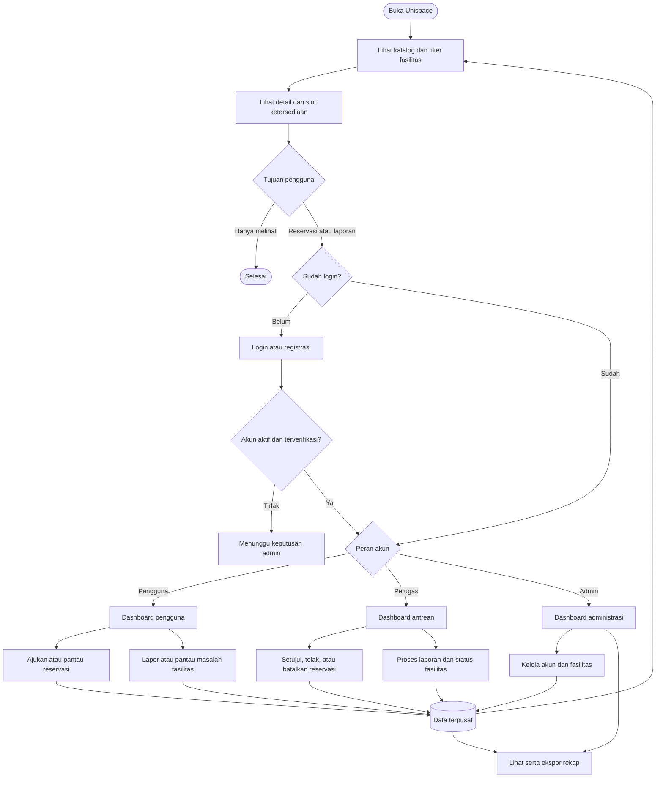
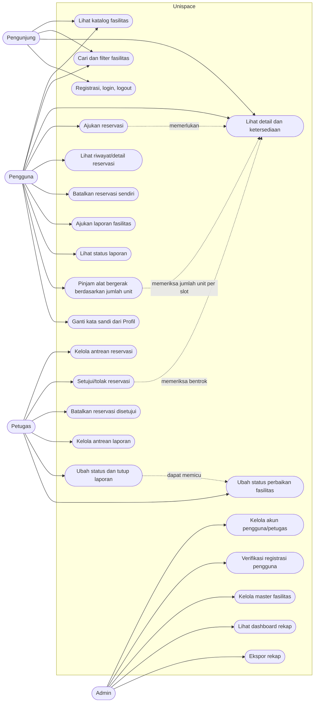
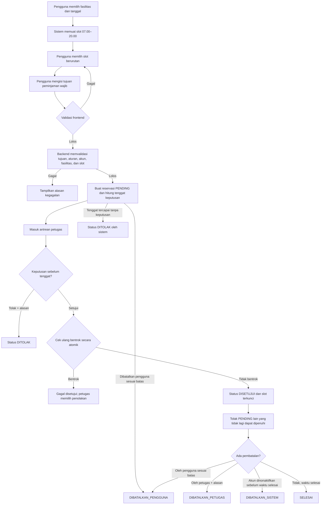
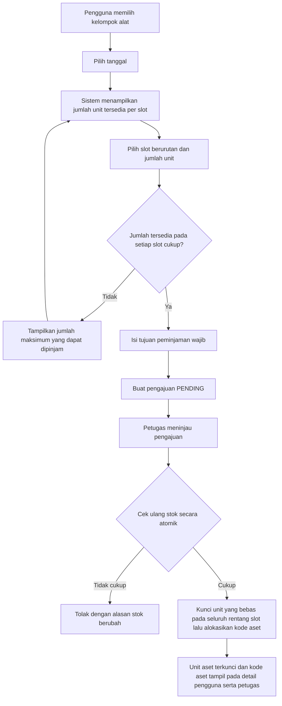
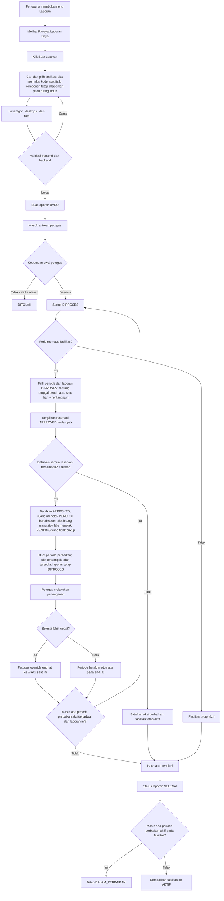
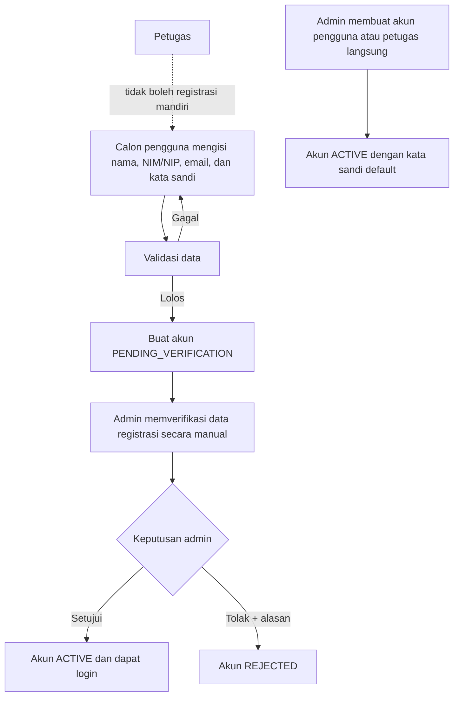
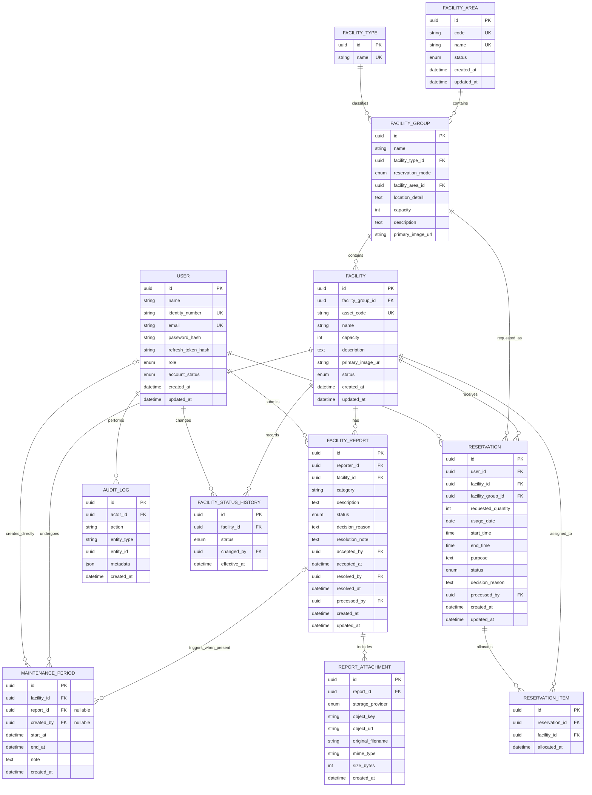

# Product Requirements Document Unispace

## 1. Ringkasan

Unispace adalah aplikasi web untuk melihat ketersediaan, mereservasi, dan melaporkan masalah fasilitas kampus. Sistem melayani empat aktor: pengunjung, pengguna terautentikasi, petugas, dan admin.

Masalah utama yang ingin diselesaikan adalah informasi ketersediaan fasilitas yang tersebar, proses persetujuan reservasi yang sulit dilacak, risiko bentrok jadwal, dan laporan kerusakan yang tidak terhubung langsung dengan status fasilitas maupun reservasi terkait.

Unispace menyediakan satu sumber data agar:

- pengunjung dapat mencari fasilitas dan melihat slot tersedia tanpa melihat data pribadi pemesan;
- mahasiswa, dosen, dan staf dapat mengajukan reservasi serta laporan kerusakan;
- petugas dapat memproses antrean reservasi dan laporan secara terpusat;
- admin dapat mengelola akun, fasilitas, dan rekap operasional;
- perubahan status fasilitas langsung memengaruhi ketersediaan yang dilihat pengguna.

## 2. Latar Belakang dan Permasalahan

Fasilitas kampus seperti ruang kelas, aula, laboratorium, alat, dan lapangan digunakan oleh banyak pihak. Tanpa sistem terpadu, calon pengguna sulit mengetahui jadwal tersedia, petugas harus memeriksa bentrok secara manual, dan fasilitas rusak dapat tetap terpesan karena laporan kerusakan tidak terhubung dengan reservasi.

Unispace menyatukan katalog fasilitas, kalender slot, persetujuan reservasi, laporan kerusakan, status perbaikan, serta rekap admin dalam satu aplikasi berbasis peran.

## 3. Tujuan Produk

1. Menampilkan katalog dan ketersediaan fasilitas secara transparan tanpa membocorkan identitas atau tujuan pemesan.
2. Memudahkan pengguna mengajukan dan melacak reservasi dalam slot 30 menit.
3. Mencegah persetujuan reservasi yang bentrok pada fasilitas yang sama.
4. Memudahkan pengguna melaporkan kerusakan dengan konteks fasilitas yang sudah terpilih.
5. Membantu petugas memproses reservasi dan laporan tanpa ada antrean yang terlewat.
6. Menjaga sinkronisasi antara kondisi fasilitas, laporan perbaikan, dan jadwal reservasi.
7. Menyediakan data okupansi dan frekuensi kerusakan bagi admin.
8. Memenuhi ketentuan proyek: registrasi, login, logout, validasi frontend/backend, pemisahan tanggung jawab kode, dan UI yang mudah digunakan.

## 4. Ruang Lingkup

### 4.1 MVP

- katalog fasilitas dan filter tipe, fakultas/area kampus, serta kapasitas;
- detail fasilitas dan ketersediaan per tanggal/per slot 30 menit;
- registrasi pengguna, verifikasi akun, login, dan logout;
- profil pengguna dan penggantian kata sandi dengan kata sandi lama;
- dashboard berbasis peran;
- pengajuan, riwayat, detail, status, dan pembatalan reservasi;
- peminjaman alat bergerak berdasarkan jumlah unit yang tersedia pada setiap slot;
- antrean serta aksi setujui, tolak, dan batalkan oleh petugas;
- pengajuan dan riwayat laporan fasilitas dengan foto;
- pemrosesan laporan dan catatan resolusi oleh petugas;
- perubahan status fasilitas menjadi aktif, dalam perbaikan, atau nonaktif;
- manajemen pengguna, petugas, dan master fakultas/area kampus oleh admin;
- CRUD fasilitas dan penonaktifan fasilitas oleh admin;
- dashboard serta ekspor rekap okupansi dan kerusakan.

### 4.2 Tidak termasuk untuk baseline saat ini

- pembayaran atau deposit reservasi;
- reservasi berulang;
- date range/multi-hari dalam satu reservasi;
- satu pengajuan yang memuat ruang dan alat bergerak sekaligus; pengguna membuat pengajuan terpisah untuk masing-masing;
- input jam bebas di luar pilihan slot 30 menit;
- integrasi SSO;
- notifikasi WhatsApp, SMS, push, atau email otomatis;
- aplikasi mobile native;
- check-in berbasis QR;
- penjadwalan teknisi dan inventaris suku cadang;
- sinkronisasi kalender eksternal.

## 5. Aktor dan Hak Akses

| Aktor | Autentikasi | Kebutuhan utama | Batasan utama |
|---|---|---|---|
| Pengunjung | Tidak | Melihat dan mencari fasilitas, detail deskriptif, serta jadwal tersedia | Tidak melihat data atau detail reservasi, pemesan, maupun tujuan penggunaan; tidak dapat reservasi atau melapor |
| Pengguna | Ya | Reservasi, pembatalan milik sendiri, riwayat, dan laporan fasilitas | Hanya dapat mengubah data milik sendiri sesuai aturan |
| Petugas | Ya | Memproses reservasi, laporan, serta status perbaikan | Tidak membuat akun petugas dan tidak mengubah data master admin tanpa izin |
| Admin | Ya | Manajemen akun/fasilitas, dashboard, dan ekspor | Tidak dapat memproses reservasi/laporan atau mengubah status perbaikan |

Pengguna mencakup mahasiswa, dosen, dan staf kampus. Petugas tidak boleh mendaftar mandiri.

## 6. Terminologi

| Istilah | Definisi |
|---|---|
| Fasilitas | Ruang, area, atau alat bergerak yang dapat dicatat, dipesan, dan/atau dilaporkan |
| Fakultas/area kampus | Wilayah master tempat fasilitas berada. Nilainya dapat berupa fakultas, rektorat, perpustakaan, atau fasilitas umum; bukan selalu organisasi fakultas secara administratif |
| Lokasi detail | Teks bebas yang menjelaskan posisi fisik fasilitas, misalnya “Gedung C, Lantai 2, Ruang C-207”. Lokasi detail ditampilkan dan dapat dicari, tetapi bukan filter master |
| Kelompok alat | Rekaman master alat bergerak sejenis yang ditampilkan sebagai satu kartu, misalnya “Proyektor Epson EB-X06”. Nama, tipe, fakultas/area kampus, lokasi detail, kapasitas, deskripsi, dan foto utama alat adalah informasi bersama milik kelompok ini |
| Unit aset | Satu alat bergerak fisik anggota kelompok alat `QUANTITY`, dengan kode aset unik, misalnya `PRJ-007` |
| Slot | Blok waktu tetap 30 menit antara pukul 07.00–20.00 |
| Tersedia | Untuk ruang/area: tidak memiliki reservasi disetujui dan tidak diblokir kondisi fasilitas pada slot terkait. Untuk kelompok alat: jumlah unit aktif yang masih dapat dipinjam pada slot tersebut |
| Reservasi menunggu | Pengajuan yang belum diputuskan petugas |
| Dalam perbaikan | Fasilitas masih tampil di katalog tetapi tidak dapat dipesan pada periode terdampak |
| Nonaktif | Fasilitas disembunyikan dari katalog publik dan tidak dapat dipesan |
| Laporan | Aduan masalah/kerusakan yang terhubung ke fasilitas tertentu |
| Okupansi | Persentase slot waktu operasional suatu fasilitas yang terisi oleh reservasi berstatus disetujui atau selesai dalam periode tertentu.|

## 7. Aturan Bisnis

### 7.1 Aturan yang sudah dinyatakan

1. Jam penggunaan fasilitas adalah 07.00–20.00.
2. Reservasi memakai slot tetap 30 menit; pengguna tidak mengetik waktu secara bebas.
3. `start_time` dan `end_time` harus berada dalam jam operasional dan tepat pada batas slot 30 menit.
4. Validasi penting wajib dijalankan di frontend dan kembali divalidasi di backend.
5. Pengunjung dapat melihat detail deskriptif fasilitas, seperti tipe, fakultas/area kampus, lokasi detail, kapasitas, deskripsi, foto utama, dan status ketersediaan, tetapi tidak dapat melihat data atau detail reservasi, identitas pemesan, maupun tujuan penggunaan.
6. Tujuan peminjaman wajib diisi, dipangkas dari spasi awal/akhir, tidak boleh hanya berisi spasi, dan maksimal 500 karakter. Basis data menolak nilai `NULL` maupun nilai kosong pada `purpose`; data historis yang sebelumnya kosong dinormalisasi menjadi `Tidak diisi (data lama)` saat migrasi.
7. Keputusan penolakan dan pembatalan oleh petugas wajib menyertakan alasan yang dapat dilihat pengguna.
8. Sistem tidak boleh menyetujui dua reservasi yang tumpang tindih pada ruang/area eksklusif yang sama; untuk kelompok alat, jumlah unit yang disetujui tidak boleh melebihi stok tersedia pada setiap slot.
9. Ruang/area dalam perbaikan tetap muncul di katalog, tetapi ditandai tidak tersedia. Unit alat dalam perbaikan mengurangi jumlah tersedia pada kelompok alatnya.
10. Fasilitas nonaktif tidak muncul kepada pengunjung/pengguna.
11. Pengunjung dapat melakukan registrasi mandiri hanya sebagai pengguna; akun hasil registrasi berstatus `PENDING_VERIFICATION` dan tidak dapat login sampai disetujui admin. Petugas tidak dapat melakukan registrasi mandiri.
12. Penutupan laporan sebagai selesai wajib memiliki catatan resolusi.
13. Ruang, area, dan fasilitas eksklusif dipesan sebagai satu unit untuk satu rentang slot waktu.
14. Admin membuat `FACILITY_GROUP` terlebih dahulu dan wajib memilih satu `FACILITY_AREA` aktif. Pada `QUANTITY`, kelompok menyimpan informasi katalog bersama alat—nama, tipe, fakultas/area kampus, lokasi detail, kapasitas, deskripsi, dan foto utama—kemudian admin menambah satu atau lebih unit alat fisik; setiap unit wajib memiliki kode aset unik.
15. Pengguna memilih tanggal, slot waktu berurutan, dan jumlah unit alat yang diperlukan; jumlah yang diminta tidak boleh melebihi jumlah unit tersedia pada setiap slot yang dipilih. Tidak ada batas jumlah unit tambahan per pengajuan selain ketersediaan tersebut.
16. Jumlah alat tersedia dihitung dari unit aktif dikurangi unit dalam perbaikan dan unit pada reservasi berstatus disetujui yang waktunya bertabrakan. Pengajuan `PENDING` belum mengurangi jumlah yang tampil di katalog.
17. Saat petugas menyetujui peminjaman alat, sistem secara atomik mengunci dan memilih unit aset yang bebas pada seluruh rentang slot, lalu mengalokasikannya ke reservasi. Kode aset hasil alokasi tampil pada detail reservasi pengguna dan petugas.
18. Peralatan tetap di dalam ruang, seperti TV atau AC, merupakan bagian dari ruang tersebut, bukan fasilitas atau alat tersendiri. Laporan masalahnya mengarah ke ruang induk dan komponen dapat dijelaskan pada deskripsi laporan.
19. Satu pengajuan reservasi hanya boleh memiliki satu target: satu ruang/area eksklusif atau satu kelompok alat bergerak. Pengguna yang memerlukan ruang dan alat membuat dua pengajuan terpisah.
20. Admin mengelola akun, master fasilitas, rekap, ekspor, dan audit log, tetapi tidak dapat menyetujui/menolak/membatalkan reservasi, memproses laporan, atau mengubah status perbaikan.
21. Pengguna dapat mengirim pengajuan reservasi kapan pun. Waktu pengajuan tidak dibatasi jam operasional.
22. Penggunaan fasilitas hanya tersedia pada hari operasional Senin–Jumat pukul 07.00–20.00 `Asia/Jakarta`. Hari libur khusus dan penutupan tanggal belum dikelola pada MVP.
23. Pengajuan harus dikirim paling lambat pada hari operasional H-2 dari tanggal penggunaan. H-1 dan H-2 dihitung berdasarkan Senin–Jumat, bukan hari kalender.
24. Tenggat keputusan petugas adalah pukul 20.00 pada hari operasional berikutnya setelah tanggal pengajuan, atau pukul 20.00 pada H-1 tanggal penggunaan, mana yang lebih awal.
25. Jika sampai tenggat tidak ada keputusan petugas, sistem otomatis mengubah status pengajuan dari `PENDING` menjadi `REJECTED`.
26. Satu reservasi berlaku untuk satu tanggal penggunaan dan dapat memakai seluruh slot berurutan yang tersedia pada tanggal tersebut; tidak ada batas durasi maksimum tambahan selain jam operasional 07.00–20.00.
27. Tidak ada kuota jumlah reservasi maupun total jam per pengguna per minggu pada MVP.
28. Pengguna dapat membatalkan reservasi miliknya sendiri yang masih `PENDING` atau `APPROVED` paling lambat pukul 20.00 pada H-1 tanggal penggunaan. Pembatalan mengubah status menjadi `CANCELLED_BY_USER`; H-1 dihitung berdasarkan Senin–Jumat.
29. Saat petugas menyetujui satu pengajuan, sistem langsung menolak pengajuan `PENDING` lain yang bertabrakan pada ruang/area yang sama atau yang tidak lagi dapat dipenuhi stok alatnya. Petugas bebas menentukan pengajuan yang disetujui berdasarkan tujuan pengajuan; urutan waktu pengajuan tidak memberi prioritas otomatis.
30. Petugas dapat membuat periode perbaikan dari laporan `IN_PROGRESS` atau sebagai perbaikan mandiri tanpa laporan. Keduanya memakai dua mode yang saling eksklusif: (a) rentang tanggal, yang menutup seluruh jam operasional 07.00–20.00 pada setiap tanggal dalam rentang; atau (b) satu tanggal dengan rentang jam tertentu pada batas slot 30 menit. Rentang tanggal tidak dapat memilih jam tertentu.
31. Slot dalam periode perbaikan tidak tersedia untuk reservasi. Jika periode berada di masa depan, fasilitas tetap berstatus aktif hingga periode dimulai dan detail fasilitas menampilkan informasi perbaikan terjadwal; selama periode berlangsung fasilitas berstatus `DALAM_PERBAIKAN`, kecuali fasilitas tersebut `NONACTIVE`.
32. Setelah periode perbaikan dipilih, sistem menampilkan seluruh reservasi `APPROVED` yang bertabrakan dan meminta konfirmasi untuk membatalkan semuanya sekaligus beserta satu alasan pembatalan yang wajib diisi. Jika petugas mengonfirmasi, sistem membatalkan semua reservasi `APPROVED` terdampak dengan alasan yang sama, menyimpan `cancelled_at`, dan mencatat setiap mutasi pada audit log. Untuk ruang/area eksklusif, seluruh pengajuan `PENDING` yang bertabrakan ditolak. Untuk alat bergerak, unit yang diperbaiki mengurangi stok satu unit pada slot terdampak dan sistem hanya menolak pengajuan `PENDING` yang jumlah permintaannya tidak lagi dapat dipenuhi pada sedikitnya satu slot. Jika tidak, periode perbaikan tidak dibuat dan status fasilitas tidak berubah.
33. Periode perbaikan berakhir otomatis pada `end_at`. Jika perbaikan selesai lebih cepat, petugas dapat melakukan override dengan mengubah `end_at` menjadi waktu saat ini; fasilitas kembali aktif bila tidak ada periode perbaikan lain yang masih berlangsung dan fasilitas tidak `NONACTIVE`.
34. Foto bukti wajib diunggah pada setiap laporan; pengguna dapat mengunggah 1–3 foto berformat JPEG, PNG, atau WebP dengan ukuran maksimum 5 MB per foto.
35. Setiap alat bergerak wajib memiliki kode aset fisik unik. Laporan masalah alat bergerak harus mengarah ke unit aset berkode fisik tersebut, sedangkan masalah peralatan tetap di dalam ruang dilaporkan pada ruang induknya.
36. Tanggal penggunaan paling jauh adalah 14 hari kalender sejak tanggal pengajuan.
37. Admin tidak dapat menonaktifkan fasilitas yang masih memiliki reservasi `APPROVED` dengan waktu penggunaan yang belum selesai. Sistem menolak aksi penonaktifan dan mengarahkan admin untuk meminta petugas membatalkan reservasi tersebut terlebih dahulu. Pengajuan `PENDING` tidak memblokir penonaktifan dan langsung ditolak saat fasilitas menjadi nonaktif. Saat fasilitas diaktifkan kembali ketika periode perbaikan masih berlangsung, fasilitas kembali berstatus `DALAM_PERBAIKAN`.
38. Saat admin menonaktifkan akun pengguna, seluruh pengajuan `PENDING` pengguna langsung ditolak dan seluruh reservasi `APPROVED` pengguna yang waktu selesainya belum terlewati dibatalkan oleh sistem. Histori reservasi yang telah selesai tidak berubah.
39. Kategori laporan berbeda dari tipe fasilitas. Nilai kategori yang tersedia adalah `Kerusakan Fisik`, `Listrik/Elektronik`, `Kebersihan`, `Furnitur/Perlengkapan`, `Keamanan`, dan `Lainnya`.
40. `NONACTIVE` memiliki prioritas tertinggi atas status fasilitas: fasilitas nonaktif disembunyikan dari katalog dan tidak dapat dipesan, walaupun memiliki periode perbaikan aktif/terjadwal. Jika tidak nonaktif, `DALAM_PERBAIKAN` berlaku hanya selama sedikitnya satu periode perbaikan aktif; selain itu statusnya `ACTIVE`.
41. Periode perbaikan dapat berasal dari tepat satu laporan fasilitas berstatus `IN_PROGRESS` atau dibuat sebagai perbaikan mandiri oleh petugas. Hanya periode yang terhubung ke laporan yang menahan laporan tersebut pada status `IN_PROGRESS`; laporan tidak dapat diubah menjadi `RESOLVED` selama masih memiliki periode terhubung yang aktif atau terjadwal. Perbaikan mandiri tidak memiliki `report_id`, tetapi menyimpan petugas pembuat dan audit log. Satu laporan dapat memiliki nol atau lebih periode perbaikan.
42. Akun pengguna dan petugas yang dibuat langsung oleh admin selalu memakai kata sandi awal `DEFAULT_USER_PASSWORD` dari konfigurasi `.env`. Admin menyampaikan kata sandi awal tersebut kepada pemilik akun di luar aplikasi; semua akun terautentikasi (`USER`, `STAFF`, dan `ADMIN`) dapat mengganti kata sandinya sendiri dari Profil setelah memasukkan kata sandi lama yang benar.
43. Laporan `IN_PROGRESS` merupakan antrean bersama: setiap petugas boleh melanjutkan pemrosesan laporan. Sistem menyimpan petugas serta waktu penerimaan pertama (`accepted_by`, `accepted_at`), petugas serta waktu penyelesaian (`resolved_by`, `resolved_at`), dan seluruh aksi manual pada audit log.
44. `FACILITY_AREA` adalah master wilayah kampus yang dapat bernilai fakultas maupun wilayah nonfakultas, seperti Rektorat atau Fasilitas Umum. Setiap area memiliki `code` dan `name` unik serta status `ACTIVE` atau `NONACTIVE`.
45. Setiap `FACILITY_GROUP` wajib terhubung ke tepat satu `FACILITY_AREA` aktif dan memiliki `location_detail` tidak kosong dengan panjang maksimal 500 karakter. `location_detail` adalah informasi posisi fisik bebas, bukan entitas master dan bukan filter katalog.
46. Hanya admin yang dapat membuat, melihat, mengubah, dan menonaktifkan/mengaktifkan `FACILITY_AREA`. Penghapusan fisik tidak diizinkan untuk menjaga histori dan integritas referensi. Area tidak dapat dinonaktifkan selama masih memiliki `FACILITY_GROUP`; admin wajib memindahkan kelompok fasilitas tersebut ke area aktif lain terlebih dahulu.
47. Katalog dan rekap dapat memfilter fasilitas berdasarkan `FACILITY_AREA`. Pencarian teks dapat mencocokkan nama fasilitas, deskripsi, dan `location_detail`, tetapi tidak menyediakan filter master berdasarkan lokasi detail.

### 7.2 Asumsi 

1. Zona waktu sistem adalah `Asia/Jakarta`.
2. **Keputusan dikonfirmasi:** hari operasional adalah Senin–Jumat pukul 07.00–20.00; sistem belum mengelola hari libur atau penutupan tanggal khusus pada MVP.
3. Satu reservasi hanya untuk satu target—satu ruang/area atau satu kelompok alat—dan satu tanggal, tetapi dapat mencakup beberapa slot berurutan. Ruang dan alat selalu diajukan terpisah.
4. Pengajuan yang masih menunggu boleh tumpang tindih. Setelah satu pengajuan disetujui, pengajuan menunggu yang tidak lagi dapat dipenuhi langsung ditolak oleh sistem.
5. Admin membuat `FACILITY_GROUP` sebelum unit fasilitasnya dan memilih satu `FACILITY_AREA` aktif. Ruang/area dicatat sebagai unit fisik pada kelompok `EXCLUSIVE`. Alat bergerak dikelompokkan pada katalog berdasarkan jenis/model dalam kelompok `QUANTITY`; nama, tipe, fakultas/area kampus, lokasi detail, kapasitas, deskripsi, dan foto utama dikelola bersama pada kelompok tersebut. Admin kemudian menambah unit fisik berkode aset unik hanya untuk alokasi, riwayat, kondisi, dan pelaporan kerusakan. Unit dapat dinonaktifkan tanpa menghapus histori.
6. **Keputusan dikonfirmasi:** registrasi mandiri wajib memuat nama, NIM/NIP, email, dan kata sandi. NIM/NIP serta email harus unik. Akun hasil registrasi berstatus `PENDING_VERIFICATION` dan belum dapat login sampai disetujui admin. Admin dapat membuat akun pengguna dan petugas secara langsung sebagai akun aktif dengan kata sandi awal dari `DEFAULT_USER_PASSWORD`.
7. Data historis tidak dihapus permanen; akun/fasilitas dinonaktifkan agar audit tetap utuh.
8. Untuk MVP, peminjaman alat bergerak memakai slot 30 menit serta jam operasional yang sama dengan reservasi ruang; peminjaman multi-hari dan proses pengambilan/pengembalian fisik yang terpisah belum termasuk alur inti.

## 8. Gambaran Alur Sistem

## 9. Diagram Use Case

## 10. Alur Utama per Domain

### 10.1 Reservasi

Status reservasi saat ini: `PENDING`, `APPROVED`, `REJECTED`, `CANCELLED_BY_USER`, `CANCELLED_BY_STAFF`, `CANCELLED_BY_SYSTEM`, `COMPLETED`

### 10.1.1 Peminjaman alat bergerak duplikat

Untuk contoh 10 proyektor: admin terlebih dahulu membuat kelompok alat “Proyektor Epson EB-X06”, memilih area `Fasilitas Umum`, lalu mengisi lokasi detail “Pusat Media, Gedung A Lantai 1”, tipe, kapasitas, deskripsi, dan foto utamanya sebagai informasi bersama, kemudian menambahkan 10 unit fisik dengan kode aset unik. Jika 1 unit sedang dalam perbaikan dan 4 unit sudah berada pada reservasi `APPROVED` pukul 09.00–11.00, maka pengguna hanya dapat mengajukan paling banyak 5 proyektor pada seluruh slot dalam rentang waktu tersebut. Pengguna memilih jumlah alat, bukan nomor aset; saat persetujuan sistem mengunci unit yang bebas pada seluruh rentang slot, mengalokasikan kodenya, dan menampilkannya pada detail reservasi pengguna serta petugas.

### 10.2 Pelaporan fasilitas

Status laporan : `NEW`, `IN_PROGRESS`, `RESOLVED`, `REJECTED`.

Petugas juga dapat menjadwalkan **perbaikan mandiri** dari katalog fasilitas tanpa membuat atau memilih laporan. Alur validasi window, pratinjau dampak, konfirmasi pembatalan, penguncian ketersediaan, dan auditnya sama dengan perbaikan dari laporan. Perbedaan satu-satunya adalah `report_id` kosong; periode mandiri tidak menahan status laporan mana pun.

### 10.3 Registrasi dan verifikasi akun

Registrasi mandiri hanya menghasilkan akun pengguna yang menunggu verifikasi. Admin tetap dapat membuat akun pengguna dan petugas langsung dengan kata sandi awal `DEFAULT_USER_PASSWORD`; akun petugas tidak pernah dapat dibuat melalui registrasi mandiri.

## 11. Functional Requirements

Prioritas: **Must** = wajib untuk memenuhi alur inti/tugas; **Should** = penting tetapi dapat dijadwalkan setelah alur inti; **Could** = peningkatan opsional.

### 11.1 Autentikasi dan akun

| ID | Prioritas | Kebutuhan fungsional | Kriteria penerimaan ringkas |
|---|---|---|---|
| FR-AUTH-01 | Must | Sistem menyediakan registrasi mandiri untuk pengguna | Nama, NIM/NIP, email, dan kata sandi wajib tervalidasi; NIM/NIP serta email unik; role tidak dapat dipilih menjadi petugas/admin; akun baru berstatus `PENDING_VERIFICATION` |
| FR-AUTH-02 | Must | Sistem menyediakan login | Kredensial valid dari akun `ACTIVE` menghasilkan sesi. Backend menyimpan hash refresh token pada `USER`, menggantikan hash sebelumnya sehingga satu akun hanya memiliki satu refresh token aktif; akun `PENDING_VERIFICATION`, nonaktif, atau ditolak tidak dapat login |
| FR-AUTH-03 | Must | Sistem menyediakan logout | Backend mengosongkan `USER.refresh_token_hash` dan browser menghapus token/cookie terkait; refresh token yang telah dicabut tidak dapat dipakai lagi dan halaman privat tidak dapat diakses lagi |
| FR-AUTH-04 | Must | Sistem mengarahkan akun ke dashboard sesuai role | Pengguna, petugas, dan admin memperoleh navigasi serta izin yang berbeda |
| FR-AUTH-05 | Must | Backend menerapkan role-based access control | Akses URL/API yang tidak sesuai role ditolak, bukan hanya disembunyikan di UI; admin tidak diberi akses aksi operasional petugas |
| FR-AUTH-06 | Must | Admin dapat memverifikasi secara manual lalu menyetujui/menolak registrasi pengguna | Admin memeriksa data registrasi termasuk NIM/NIP tanpa integrasi direktori kampus; keputusan, waktu, admin, dan alasan penolakan tersimpan |
| FR-AUTH-07 | Must | Admin dapat membuat akun pengguna dan petugas langsung | Nama, NIM/NIP, dan email unik; akun yang dibuat admin berstatus `ACTIVE` dengan hash dari `DEFAULT_USER_PASSWORD` pada `.env`; admin menyampaikan kata sandi awal di luar aplikasi dan petugas hanya dapat dibuat admin |
| FR-AUTH-08 | Must | Admin dapat menonaktifkan/mengaktifkan akun | Akun nonaktif tidak dapat login dan `refresh_token_hash` dikosongkan; saat dinonaktifkan, `PENDING` langsung menjadi `REJECTED` dan `APPROVED` yang waktu selesainya belum terlewati menjadi `CANCELLED_BY_SYSTEM`; histori selesai tetap tersedia |
| FR-AUTH-09 | Must | Admin dapat mereset kata sandi pengguna atau petugas ke kata sandi default | Tombol reset mengganti hash kata sandi lama dengan nilai `DEFAULT_USER_PASSWORD` dari konfigurasi `.env`; aksi hanya dapat dilakukan admin, tidak mengungkap nilai kata sandi pada UI, dan tercatat pada audit log |
| FR-AUTH-10 | Must | Semua akun terautentikasi dapat mengganti kata sandi sendiri dari Profil | `USER`, `STAFF`, dan `ADMIN` memasukkan kata sandi lama dan kata sandi baru; backend memverifikasi hash kata sandi lama, menyimpan hash kata sandi baru, dan menolak kata sandi lama yang salah |
| FR-AUTH-11 | Could | Pengguna dapat mereset kata sandi jika lupa | Di luar MVP/iterasi berikutnya; memerlukan verifikasi email melalui SMTP |

### 11.2 Katalog dan fasilitas

| ID | Prioritas | Kebutuhan fungsional | Kriteria penerimaan ringkas |
|---|---|---|---|
| FR-FAC-01 | Must | Pengunjung/pengguna dapat melihat katalog fasilitas aktif | Kartu menampilkan nama, tipe, fakultas/area kampus, lokasi detail, kapasitas, status, dan foto utama. Untuk alat `QUANTITY`, seluruh informasi katalog tersebut berasal dari `FACILITY_GROUP`, yang juga menampilkan jumlah unit tersedia dari total unit aktif |
| FR-FAC-02 | Must | Pengunjung/pengguna dapat mencari dan memfilter | Filter tipe, fakultas/area kampus, kapasitas dapat digabung; default menampilkan semua fasilitas aktif. Lokasi detail dapat dicari sebagai teks, tetapi bukan filter master |
| FR-FAC-03 | Must | Pengunjung/pengguna dapat membuka detail fasilitas | Detail memuat deskripsi, fakultas/area kampus, lokasi detail, kapasitas, status, dan jadwal per tanggal tanpa data atau detail reservasi pihak lain. Detail alat `QUANTITY` memakai informasi bersama dari `FACILITY_GROUP`, bukan dari unit aset fisik |
| FR-FAC-04 | Must | Sistem menampilkan ketersediaan sebagai kartu slot 30 menit | Ruang/area menampilkan tersedia/tidak tersedia; kelompok alat menampilkan jumlah unit tersedia pada setiap slot, tanpa data pemesan kepada publik |
| FR-FAC-05 | Must | Sistem membedakan status aktif, dalam perbaikan, dan nonaktif | Prioritas status adalah `NONACTIVE` → `DALAM_PERBAIKAN` → `ACTIVE`. Slot dalam periode perbaikan tidak dapat dipesan. Sebelum periode masa depan dimulai fasilitas tetap aktif dengan informasi perbaikan terjadwal; selama periode berlangsung ruang/area tetap terlihat tetapi tidak dapat dipesan. Unit alat dalam perbaikan tetap tercatat, namun mengurangi jumlah tersedia kelompok alat; nonaktif tidak terlihat publik |
| FR-FAC-06 | Must | Admin dapat menambah dan mengubah kelompok fasilitas serta unit fisik | Admin membuat `FACILITY_GROUP` terlebih dahulu dengan satu `FACILITY_AREA` aktif dan `location_detail` yang tidak kosong. Untuk `EXCLUSIVE`, kelompok memiliki unit fisik ruang/area yang dipesan. Untuk `QUANTITY`, kelompok menyimpan nama, tipe, fakultas/area kampus, lokasi detail, kapasitas, deskripsi, dan foto utama yang tampil di katalog; admin kemudian menambah satu atau lebih unit alat dengan `asset_code` unik tanpa mengisi ulang informasi katalog tersebut. Foto utama wajib diunggah pada catatan yang tampil di katalog—unit ruang/area `EXCLUSIVE` atau `FACILITY_GROUP` `QUANTITY`; sistem menolak penyimpanan tanpa foto. Field wajib divalidasi dan perubahan dicatat pada audit log |
| FR-FAC-07 | Must | Admin dapat menonaktifkan/mengaktifkan fasilitas atau unit alat | Penonaktifan tidak menghapus histori. Unit `QUANTITY` yang nonaktif tidak lagi dihitung sebagai stok tersedia, tetapi histori dan kode asetnya tetap ada. Aksi ditolak bila target masih memiliki reservasi `APPROVED` yang waktu penggunaannya belum selesai, dan sistem mengarahkan admin meminta petugas membatalkannya terlebih dahulu. Pengajuan `PENDING` tidak memblokir penonaktifan dan langsung menjadi `REJECTED` bila target berhasil dinonaktifkan. Saat fasilitas diaktifkan kembali, periode perbaikan yang masih aktif mengembalikan statusnya ke `DALAM_PERBAIKAN` |
| FR-FAC-08 | Should | Admin dapat mengganti foto utama fasilitas | Foto utama yang diwajibkan saat fasilitas dibuat dapat diganti admin pada unit ruang/area `EXCLUSIVE` atau pada `FACILITY_GROUP` `QUANTITY`; file memakai aturan keamanan unggahan dan object storage yang sama dengan foto laporan |
| FR-FAC-09 | Must | Admin dapat mengelola master fakultas/area kampus | Admin dapat membuat, melihat, mengubah, mengaktifkan, dan menonaktifkan `FACILITY_AREA`. `code` 2–30 karakter huruf besar/angka/garis bawah dan `name` 2–120 karakter wajib unik serta tidak kosong. Area tidak dihapus fisik dan tidak dapat dinonaktifkan bila masih direferensikan `FACILITY_GROUP`; admin harus memindahkan fasilitas ke area aktif lain terlebih dahulu |
| FR-FAC-10 | Must | Petugas dapat menjadwalkan perbaikan mandiri dari fasilitas | Periode dapat dibuat tanpa laporan untuk fasilitas aktif, memakai window valid yang sama dengan perbaikan dari laporan. Backend mengunci ketersediaan, mempratinjau ulang dampak dalam transaksi, mewajibkan konfirmasi dan alasan pembatalan, serta mencatat periode dan setiap reservasi terdampak pada audit log. Permintaan konfirmasi mendukung `Idempotency-Key` |

### 11.3 Reservasi

| ID | Prioritas | Kebutuhan fungsional | Kriteria penerimaan ringkas |
|---|---|---|---|
| FR-RES-01 | Must | Pengguna dapat memilih tanggal dan satu/lebih slot berurutan | Tidak ada input jam bebas; slot di luar jam/hari operasional atau lebih dari 14 hari kalender ke depan tidak ditampilkan |
| FR-RES-02 | Must | Sistem menerima tujuan peminjaman wajib | Tujuan dipangkas, maksimal 500 karakter, dan tidak boleh kosong atau hanya spasi. Backend dan database menolak nilai `NULL` maupun teks kosong |
| FR-RES-03 | Must | Backend memvalidasi aturan waktu dan fasilitas | Validasi meliputi hari operasional, jam, kelipatan 30 menit, satu tanggal penggunaan, lead time H-2 operasional, batas 14 hari kalender, status akun, dan status fasilitas |
| FR-RES-04 | Must | Sistem membuat pengajuan berstatus menunggu | Pengguna menerima nomor/detail pengajuan, status `PENDING`, dan tenggat keputusan; entri terlihat oleh petugas |
| FR-RES-05 | Must | Pengguna dapat melihat daftar, detail, dan status reservasi sendiri | Alasan penolakan atau pembatalan dan timestamp tampil jika ada. Untuk peminjaman alat yang telah `APPROVED`, detail menampilkan kode aset fisik hasil alokasi |
| FR-RES-06 | Must | Petugas dapat memfilter antrean berdasarkan status | Minimal `PENDING` dan `APPROVED`; filter tanggal/fasilitas disarankan |
| FR-RES-07 | Must | Petugas dapat menyetujui pengajuan | Sistem memeriksa bentrok kembali dalam transaksi sebelum menyimpan persetujuan |
| FR-RES-08 | Must | Petugas dapat menolak dengan alasan | Alasan wajib dan terlihat oleh pemohon |
| FR-RES-09 | Must | Sistem mencegah konflik reservasi disetujui | Dua aksi persetujuan bersamaan tidak boleh menghasilkan double booking pada ruang/area eksklusif atau jumlah peminjaman alat yang melebihi stok |
| FR-RES-10 | Must | Pengguna dapat membatalkan reservasi `PENDING` atau `APPROVED` milik sendiri sampai pukul 20.00 H-1 | Aksi setelah batas ditolak; status menjadi `CANCELLED_BY_USER` dan waktu pembatalan disimpan |
| FR-RES-11 | Must | Petugas dapat membatalkan reservasi disetujui dengan alasan | Alasan wajib, terlihat pengguna, dan slot dilepas |
| FR-RES-12 | Must | Reservasi yang telah berakhir menjadi selesai | Dapat dihitung saat baca atau melalui proses terjadwal; histori tidak hilang |
| FR-RES-13 | Must | Sistem menolak pengajuan `PENDING` yang tidak lagi dapat dipenuhi setelah ada persetujuan | Setelah satu pengajuan disetujui, pengajuan menunggu yang bentrok pada ruang/area atau stok alatnya tidak lagi cukup berubah menjadi `REJECTED`; petugas menentukan pengajuan yang disetujui berdasarkan evaluasi tujuan |
| FR-RES-14 | Must | Pengguna dapat meminjam alat bergerak dari kelompok alat | Pengguna memilih tanggal, slot berurutan, serta jumlah unit tanpa perlu memilih kode aset fisik |
| FR-RES-15 | Must | Sistem menghitung jumlah alat yang dapat dipinjam per slot | Jumlah tersedia = unit aktif − unit dalam perbaikan − unit pada reservasi `APPROVED` yang tumpang tindih; pengajuan `PENDING` tidak mengurangi angka publik |
| FR-RES-16 | Must | Sistem menjamin peminjaman alat tidak melebihi stok | Backend memeriksa kecukupan stok pada setiap slot dan mengulang pemeriksaan dalam transaksi saat persetujuan. Sistem mengunci serta mengalokasikan hanya unit aset yang bebas pada seluruh rentang slot, sehingga satu kode aset tidak dapat dialokasikan ke dua reservasi `APPROVED` yang bertumpang tindih. Kode aset hasil alokasi tampil pada detail pengguna dan petugas |
| FR-RES-17 | Should | Petugas dapat mencatat serah-terima dan pengembalian alat secara manual | Kode aset, waktu, dan kondisi alat saat serah-terima/pengembalian tercatat; fitur ini tidak memakai QR dan dapat dijadwalkan setelah MVP |
| FR-RES-18 | Must | Sistem menolak pengajuan yang tidak diputus sampai tenggat | Pada pukul 20.00 di tenggat keputusan, `PENDING` berubah menjadi `REJECTED` |

### 11.4 Laporan kerusakan/masalah

| ID | Prioritas | Kebutuhan fungsional | Kriteria penerimaan ringkas |
|---|---|---|---|
| FR-REP-01 | Must | Pengguna memulai laporan melalui menu Laporan dan mencari/memilih fasilitas | Fasilitas wajib dipilih melalui pencarian sebelum form dapat dikirim. Laporan alat bergerak wajib memilih unit aset berdasarkan kode aset fisik. TV, AC, atau komponen tetap lain di dalam ruang tidak dipilih sebagai aset tersendiri, tetapi dilaporkan pada ruang induknya |
| FR-REP-02 | Must | Pengguna mengisi kategori dan deskripsi | Kategori wajib dipilih dari `Kerusakan Fisik`, `Listrik/Elektronik`, `Kebersihan`, `Furnitur/Perlengkapan`, `Keamanan`, atau `Lainnya`; kategori bukan tipe fasilitas dan field tervalidasi di frontend/backend |
| FR-REP-03 | Must | Pengguna mengunggah foto bukti | Minimal 1 dan maksimum 3 foto wajib diunggah; hanya JPEG, PNG, atau WebP berukuran maksimum 5 MB per foto yang diterima. File disimpan di MinIO atau S3; URL/link dan metadata file tersimpan di PostgreSQL |
| FR-REP-04 | Must | Sistem membuat laporan berstatus baru | Nomor laporan, pelapor, fasilitas, dan waktu tersimpan |
| FR-REP-05 | Must | Pengguna dapat melihat daftar, detail, dan status laporan sendiri | Catatan/alasan petugas yang boleh dibagikan tampil kepada pengguna |
| FR-REP-06 | Must | Petugas dapat melihat dan memfilter antrean laporan | Minimal filter baru, diproses, selesai, ditolak, fasilitas, dan tanggal |
| FR-REP-07 | Must | Petugas dapat menerima laporan untuk diproses dalam antrean bersama | Petugas pertama yang mengubah `NEW` menjadi `IN_PROGRESS` tersimpan pada `accepted_by` dan `accepted_at`. Laporan tetap dapat dilanjutkan oleh petugas lain; setiap aksi manual mencatat pelaku dan waktu pada audit log |
| FR-REP-08 | Must | Petugas dapat menolak laporan dengan alasan | Alasan wajib dan dapat dilihat pelapor |
| FR-REP-09 | Must | Petugas dapat menyelesaikan laporan dengan catatan resolusi | Catatan resolusi wajib sebelum status selesai; `resolved_by` dan `resolved_at` tersimpan. Aksi ditolak selama laporan masih memiliki periode perbaikan aktif atau terjadwal yang terhubung ke laporan tersebut; laporan tetap `IN_PROGRESS` sampai seluruh periode itu berakhir atau diakhiri lebih awal |
| FR-REP-10 | Must | Petugas dapat membuat periode perbaikan fasilitas dari laporan | Periode yang dibuat dari laporan wajib terhubung ke satu laporan `IN_PROGRESS`. Petugas dapat memilih masa kini/masa depan dengan rentang tanggal penuh 07.00–20.00 atau satu tanggal dengan rentang jam slot 30 menit; slot terdampak tidak dapat dipesan. Rentang tanggal tidak dapat dipadukan dengan pemilihan jam tertentu |
| FR-REP-11 | Must | Petugas dapat mengakhiri periode perbaikan lebih awal | Petugas dapat mengubah `end_at` ke waktu saat ini sebagai override; fasilitas kembali aktif bila tidak ada periode perbaikan lain yang masih berlangsung dan fasilitas tidak `NONACTIVE` |
| FR-REP-12 | Must | Sistem menangani reservasi terdampak perbaikan | Sistem menampilkan `APPROVED` yang tumpang tindih dan meminta konfirmasi pembatalan massal dengan satu alasan; setelah dikonfirmasi, semua `APPROVED` terdampak dibatalkan. Untuk ruang/area, semua `PENDING` yang bertabrakan ditolak; untuk alat, sistem mengurangi stok unit yang diperbaiki dan hanya menolak `PENDING` yang jumlahnya tidak lagi cukup pada salah satu slot sebelum periode dibuat. Bila konfirmasi ditolak, periode perbaikan tidak dibuat |

### 11.5 Dashboard, administrasi, dan rekap

| ID | Prioritas | Kebutuhan fungsional | Kriteria penerimaan ringkas |
|---|---|---|---|
| FR-ADM-01 | Must | Petugas melihat ringkasan antrean | Jumlah reservasi menunggu dan laporan baru/diproses tampil serta dapat dibuka |
| FR-ADM-02 | Must | Admin melihat daftar dan detail pengguna/petugas | Dapat dicari/filter berdasarkan role dan status |
| FR-ADM-03 | Must | Admin melihat dashboard okupansi dan utilisasi alat | Dapat difilter berdasarkan periode, fasilitas, tipe, dan fakultas/area kampus; fasilitas nonaktif tetap tampil sebagai daftar nonaktif pada rekap/riwayat, tetapi slot sejak `effective_at` nonaktif tidak masuk pembagi. Slot/unit-slot dalam maintenance tetap masuk pembagi |
| FR-ADM-04 | Must | Admin melihat frekuensi laporan kerusakan | Rekap per fasilitas/fakultas-area kampus/kategori dengan periode berdasarkan `created_at`; menghitung laporan `NEW`, `IN_PROGRESS`, dan `RESOLVED`, tidak menghitung `REJECTED` |
| FR-ADM-05 | Must | Admin mengekspor rekap ke CSV, Excel, dan PDF | Hasil mengikuti filter aktif dan memuat periode pembuatan |
| FR-ADM-06 | Must | Sistem mencatat audit aktivitas penting | Login, keputusan akun, mutasi fasilitas, reservasi, laporan, dan ekspor tercatat |
| FR-ADM-07 | Should | Admin dapat melihat detail audit log | Filter pelaku, aksi, entitas, dan waktu; log tidak dapat diubah dari UI |
| FR-ADM-08 | Could | Dashboard menampilkan tren/grafik | Grafik konsisten dengan angka rekap dan filter aktif |

## 12. Matriks Izin Ringkas

| Kapabilitas | Pengunjung | Pengguna | Petugas | Admin |
|---|:---:|:---:|:---:|:---:|
| Lihat katalog/ketersediaan | Ya | Ya | Ya | Ya |
| Ajukan reservasi | Tidak | Ya | Tidak | Tidak |
| Batalkan reservasi sendiri | Tidak | Ya | Tidak | Tidak |
| Ajukan laporan | Tidak | Ya | Tidak | Tidak |
| Ganti kata sandi sendiri dari Profil | Tidak | Ya | Ya | Ya |
| Proses reservasi/laporan | Tidak | Tidak | Ya | Tidak |
| Ubah status perbaikan | Tidak | Tidak | Ya | Tidak |
| Kelola akun | Tidak | Tidak | Tidak | Ya |
| Kelola master fasilitas | Tidak | Tidak | Tidak | Ya |
| Kelola master fakultas/area kampus | Tidak | Tidak | Tidak | Ya |
| Lihat/ekspor rekap global | Tidak | Tidak | Tidak | Ya |

## 13. Kebutuhan Data Konseptual

Catatan data:

- Foto laporan disimpan sebagai objek pada MinIO atau S3. Untuk setiap foto, PostgreSQL menyimpan baris `REPORT_ATTACHMENT` berisi provider, `object_key`, URL/link, nama berkas asal, MIME type, ukuran, dan waktu unggah; satu laporan dapat memiliki lebih dari satu foto.
- Foto utama wajib tersimpan pada catatan katalog yang benar: `FACILITY.primary_image_url` untuk ruang/area `EXCLUSIVE`, dan `FACILITY_GROUP.primary_image_url` untuk alat `QUANTITY`. Foto tersebut memakai object storage yang sama dengan foto laporan dan dapat diganti tanpa menghapus histori.
- Kapasitas sebaiknya bilangan bulat non-negatif, bukan free text, agar filter dan rekap dapat dihitung. Untuk alat `QUANTITY`, nilai kapasitas berada pada kelompok alat sebagai informasi katalog bersama dan dapat bernilai `1` atau nullable bila kapasitas tidak relevan untuk jenis alat tersebut.
- `FACILITY_AREA` adalah master wilayah kampus untuk fakultas maupun area nonfakultas, misalnya Rektorat dan Fasilitas Umum. `code` dan `name` unik; `status` menentukan apakah area dapat dipilih saat fasilitas dibuat atau dipindahkan. Setiap `FACILITY_GROUP` wajib memiliki satu `facility_area_id`, sehingga fasilitas umum tetap dipetakan ke area seperti `FASILITAS_UMUM`, bukan nilai kosong.
- `location_detail` berada pada `FACILITY_GROUP` sebagai teks bebas, wajib tidak kosong dan maksimal 500 karakter. Contoh nilainya “Gedung C, Lantai 2, Ruang C-207”. Kolom ini tidak dinormalisasi menjadi master `LOCATION`, karena format detail dapat bervariasi; ia ditampilkan pada kartu/detail dan menjadi bagian dari pencarian teks, bukan filter katalog tersendiri.
- Admin membuat `FACILITY_GROUP` terlebih dahulu. Kelompok hanya memiliki dua mode: `EXCLUSIVE` untuk ruang/area dan `QUANTITY` untuk alat bergerak sejenis. Setiap `FACILITY` adalah unit fisik/aset pada kelompoknya. Pada `EXCLUSIVE`, unit fisik menyimpan informasi katalog ruang/area. Pada `QUANTITY`, kelompok menyimpan nama, tipe, fakultas/area kampus, lokasi detail, kapasitas, deskripsi, dan foto utama yang digunakan seluruh unit; unit alat hanya menyimpan kode aset, status, kondisi perbaikan, serta histori. Karena itu, kolom `name`, `capacity`, `description`, dan `primary_image_url` pada unit `FACILITY` `QUANTITY` tidak diisi atau dibaca sebagai informasi katalog; kolom tersebut wajib diisi pada `FACILITY_GROUP` `QUANTITY`. Kelompok `QUANTITY` memiliki satu atau lebih unit alat dengan `asset_code` unik; penonaktifan unit tidak menghapus histori atau kode asetnya.
- Area tidak pernah dihapus fisik. Sebelum admin menonaktifkan area, sistem memeriksa bahwa tidak ada `FACILITY_GROUP` yang masih merujuknya; semua kelompok harus dipindahkan ke area aktif lain terlebih dahulu. Pembatasan ini menjaga setiap fasilitas historis tetap dapat dibaca bersama area asalnya.
- Reservasi ruang menggunakan `facility_id`; peminjaman alat menggunakan `facility_group_id` dan `requested_quantity`. Setelah disetujui, baris `RESERVATION_ITEM` mencatat unit aset yang benar-benar dialokasikan. Dalam satu transaksi, implementasi wajib mengunci dan hanya memilih unit yang bebas pada seluruh rentang slot sehingga satu `asset_code` tidak dapat dialokasikan pada dua reservasi `APPROVED` bertumpang tindih. Kode hasil alokasi tampil pada detail reservasi pengguna dan petugas. Ruang dan alat tidak dapat digabung dalam satu pengajuan.
- `RESERVATION.purpose` wajib berupa teks setelah dipangkas, maksimal 500 karakter, dan tidak boleh `NULL` atau kosong. Migrasi data lama mengganti nilai kosong menjadi `Tidak diisi (data lama)` sebelum constraint `NOT NULL` serta check nonblank diterapkan.
- Setiap laporan mengarah ke `facility_id`. Untuk alat bergerak, `facility_id` wajib merujuk unit aset dengan `asset_code` fisik; kelompok alatnya menjadi informasi turunan untuk pengelompokan dan rekap. TV, AC, dan komponen tetap lain bukan `FACILITY` terpisah, melainkan bagian dari ruang induk sehingga laporannya mengarah ke `facility_id` ruang tersebut.
- Pada reservasi, `processed_by` mereferensikan petugas yang mengambil keputusan manual; nilainya dapat kosong pada aksi sistem. Pada laporan, `accepted_by`/`accepted_at` mencatat petugas penerima pertama, `resolved_by`/`resolved_at` mencatat petugas yang menyelesaikan, dan `processed_by` menyimpan pelaku aksi manual terakhir. Laporan `IN_PROGRESS` tidak dikunci ke satu petugas; `AUDIT_LOG` menyimpan seluruh aksi manual beserta pelaku dan waktunya.
- `USER.identity_number` menyimpan NIM atau NIP sebagai teks agar angka awal tidak hilang; nilai ini unik bersama email dan diverifikasi manual oleh admin saat memverifikasi registrasi. Tidak ada integrasi direktori kampus pada MVP.
- `USER.refresh_token_hash` menyimpan hash, bukan refresh token mentah. Satu akun hanya memiliki satu refresh token aktif; login baru menggantikan hash sebelumnya, sedangkan logout atau penonaktifan akun mengosongkan nilainya.
- `FACILITY_STATUS_HISTORY` menyimpan setiap perubahan eksplisit `ACTIVE`/`NONACTIVE` beserta `effective_at` dan admin pelakunya. Riwayat ini dipakai untuk mengecualikan slot sesudah penonaktifan dari pembagi metrik; `DALAM_PERBAIKAN` diturunkan dari `MAINTENANCE_PERIOD`.
- `MAINTENANCE_PERIOD.report_id` bersifat nullable. Jika terisi, ia merujuk satu laporan `IN_PROGRESS` dan periode itu menahan laporan dari status `RESOLVED` selama aktif atau terjadwal. Jika kosong, periode adalah perbaikan mandiri dan `created_by` menyimpan petugas pembuatnya; mutasi periode serta reservasi terdampak tetap dicatat pada `AUDIT_LOG`. `start_at` dan `end_at` menyimpan kedua mode perbaikan: rentang tanggal disimpan dari 07.00 tanggal awal sampai 20.00 tanggal akhir, sedangkan rentang jam hanya boleh berada pada satu tanggal dan batas slot 30 menit.
- Kalender/libur kampus dapat menjadi entitas tersendiri pada iterasi berikutnya jika operasi tidak selalu Senin–Jumat reguler.

## 14. Validasi dan Penanganan Kasus Tepi

### 14.0 Validasi akun dan autentikasi

- nama wajib dinormalisasi dengan menghapus spasi di awal/akhir dan merangkum spasi berurutan; panjangnya 2–120 karakter serta hanya boleh berisi huruf Unicode, spasi, apostrof, titik, atau tanda hubung;
- NIM/NIP disimpan sebagai teks agar angka awal tidak hilang, wajib terdiri dari 8–30 digit, dan tidak boleh dinormalisasi menjadi angka;
- email wajib valid, maksimal 320 karakter, dipangkas, lalu disimpan dalam huruf kecil sebelum pemeriksaan unik;
- kata sandi baru wajib berupa string 12–24 karakter. Spasi tidak dipangkas atau diubah karena merupakan bagian dari kata sandi;
- email atau NIM/NIP yang sudah terdaftar tidak dapat dipakai ulang, termasuk bila akun sebelumnya berstatus `REJECTED` atau `NONACTIVE`; histori akun dipertahankan dan API mengembalikan konflik tanpa membocorkan field mana yang sama;
- login hanya memakai email dan kata sandi. Hanya akun `ACTIVE` yang memperoleh sesi; login akun `PENDING_VERIFICATION`, `REJECTED`, atau `NONACTIVE` mengembalikan kode status akun agar UI dapat menampilkan halaman status yang sesuai;
- refresh token disimpan sebagai cookie `HttpOnly`, bukan body response atau storage JavaScript. Access token dikirim dalam body login/refresh dan dipakai sebagai Bearer token;
- setiap endpoint privat memuat ulang status akun dari basis data. Perubahan role atau penonaktifan langsung berlaku walaupun access token lama belum kedaluwarsa.

### 14.1 Validasi reservasi

- tanggal tidak berada di masa lalu;
- hari dan jam berada dalam kalender operasional;
- waktu mulai lebih kecil dari waktu selesai;
- batas waktu tepat pada kelipatan 30 menit;
- slot dipilih berurutan dan masih tersedia;
- tanggal penggunaan memenuhi minimal H-2 hari operasional dari tanggal pengajuan;
- tanggal penggunaan tidak lebih dari 14 hari kalender sejak tanggal pengajuan;
- akun aktif dan terverifikasi;
- tujuan peminjaman wajib diisi setelah dipangkas, maksimal 500 karakter, dan tidak boleh kosong atau hanya spasi;
- fasilitas aktif serta tidak berada dalam periode perbaikan;
- pembatalan oleh pengguna hanya diterima untuk reservasi `PENDING` atau `APPROVED` miliknya sendiri sampai pukul 20.00 H-1 tanggal penggunaan;
- periode perbaikan rentang tanggal mencakup pukul 07.00–20.00 pada setiap tanggal; periode rentang jam hanya boleh berada pada satu tanggal dan batas slot 30 menit;
- periode perbaikan hanya dapat dibuat untuk waktu saat ini atau masa depan, dengan `end_at` setelah `start_at`; override selesai lebih awal hanya dapat mengubah `end_at` periode yang masih berlangsung ke waktu saat ini;
- periode perbaikan dapat dibuat dari satu laporan `IN_PROGRESS` dengan fasilitas yang sama atau langsung oleh petugas tanpa laporan; keduanya memakai validasi window, penguncian ketersediaan, dan aturan dampak reservasi yang sama;
- laporan tidak dapat diubah menjadi `RESOLVED` bila masih memiliki periode perbaikan aktif atau terjadwal yang terhubung ke laporan tersebut;
- penggantian kata sandi dari Profil untuk semua akun terautentikasi mewajibkan kata sandi lama yang benar sebelum hash kata sandi baru disimpan;
- persetujuan ulang mengecek bentrok di level database/transaksi untuk mencegah race condition.
- untuk alat bergerak, jumlah yang diminta harus bilangan bulat positif dan tidak melebihi jumlah unit tersedia pada **setiap** slot yang dipilih;
- jumlah unit alat tersedia hanya dikurangi oleh reservasi `APPROVED` dan unit dalam perbaikan; backend menghitung ulang jumlah ini serta mengunci dan mengalokasikan unit aset yang bebas pada seluruh rentang slot dalam transaksi ketika menyetujui pengajuan.
- saat maintenance alat dibuat, setiap pengajuan `PENDING` alat dihitung ulang pada semua slot setelah unit yang diperbaiki dikurangi satu; hanya pengajuan yang tidak lagi cukup pada sedikitnya satu slot yang menjadi `REJECTED`.

### 14.2 Kasus tepi penting

| Kasus | Perilaku yang diharapkan |
|---|---|
| Dua petugas menyetujui pengajuan bertabrakan bersamaan | Hanya satu transaksi berhasil; aksi lain menerima pesan bentrok |
| Fasilitas menjadi rusak setelah reservasi disetujui | Petugas memilih periode perbaikan, lalu mengonfirmasi pembatalan seluruh reservasi `APPROVED` terdampak sekaligus dengan satu alasan. Untuk ruang/area, seluruh `PENDING` yang bertabrakan ditolak. Untuk alat, satu unit yang diperbaiki mengurangi stok dan hanya `PENDING` yang tidak lagi cukup pada sedikitnya satu slot ditolak; tanpa konfirmasi, periode perbaikan tidak dibuat |
| Perbaikan masa depan atau berakhir lebih awal | Sebelum mulai, fasilitas tetap berstatus aktif tetapi slot periode tersebut sudah tidak tersedia. Perbaikan berakhir otomatis pada `end_at`; petugas dapat mengakhiri lebih awal dengan mengubah `end_at` ke waktu saat ini |
| Petugas mencoba menyelesaikan laporan dengan maintenance aktif/terjadwal | Sistem menolak aksi hanya bila periode tersebut terhubung ke laporan; laporan tetap `IN_PROGRESS` sampai seluruh maintenance terkait berakhir atau diakhiri lebih awal |
| Petugas membuat perbaikan mandiri dengan reservasi terdampak | Sistem menghitung dampak ulang dalam transaksi di bawah lock ketersediaan. Semua `APPROVED` yang masih berstatus sama dibatalkan dengan `cancelled_at` dan audit; hanya `PENDING` yang masih memenuhi kriteria penolakan yang diubah |
| Fasilitas dinonaktifkan dengan reservasi `APPROVED` yang belum selesai | Sistem menolak aksi admin dan mengarahkan admin meminta petugas membatalkan reservasi tersebut terlebih dahulu. `PENDING` tidak menghalangi penonaktifan dan langsung menjadi `REJECTED` |
| Fasilitas diaktifkan kembali saat periode perbaikan masih aktif | Fasilitas tidak langsung menjadi `ACTIVE`; status efektifnya kembali `DALAM_PERBAIKAN` sampai semua periode perbaikan aktif berakhir |
| Pengguna membatalkan reservasi `PENDING` | Selama masih sebelum pukul 20.00 H-1, status menjadi `CANCELLED_BY_USER` dan pengajuan hilang dari antrean petugas |
| Laporan selesai tetapi ada laporan aktif lain | Fasilitas tidak otomatis aktif jika masih diblokir laporan/periode maintenance lain |
| Foto gagal diunggah | Laporan tidak dibuat sampai minimal satu foto valid berhasil diunggah |
| Akun dinonaktifkan saat masih punya reservasi | Semua `PENDING` langsung menjadi `REJECTED`; setiap `APPROVED` dengan waktu selesai belum terlewati menjadi `CANCELLED_BY_SYSTEM`. Histori reservasi yang sudah selesai tetap tersedia |
| Pengguna mengubah URL untuk melihat data orang lain | Backend mengembalikan akses ditolak/tidak ditemukan |
| Slot berubah setelah halaman lama terbuka | Backend menolak data basi dan UI memuat ulang ketersediaan |
| Alat cukup pada slot awal tetapi tidak cukup pada salah satu slot berikutnya | Pengajuan tidak dapat dikirim sampai jumlah atau rentang slot disesuaikan; sistem menampilkan jumlah maksimum yang tersedia |
| Stok alat berubah sebelum petugas menyetujui | Hanya unit aset yang masih bebas pada seluruh rentang slot dapat dikunci dan dialokasikan; pengajuan ditolak dengan alasan stok berubah bila jumlahnya tidak cukup |
| Satu unit alat rusak | Unit tersebut masuk perbaikan dan langsung mengurangi jumlah tersedia kelompok alat pada slot terdampak |
| Dua petugas memproses laporan yang sama | Laporan tetap dapat diproses keduanya sebagai antrean bersama. Petugas penerima pertama serta petugas penyelesai tersimpan pada laporan; seluruh aksi dicatat pada audit log |
| Satu pengajuan disetujui saat ada pengajuan `PENDING` yang bertabrakan | Sistem menolak pengajuan `PENDING` yang tidak lagi dapat dipenuhi; petugas memilih pengajuan yang disetujui berdasarkan evaluasi tujuan, bukan urutan pengajuan |
| Hari libur kampus | Belum ditangani khusus pada MVP; sistem tetap memakai aturan Senin–Jumat |
| Tidak ada keputusan petugas sampai tenggat | Sistem mengubah `PENDING` menjadi `REJECTED` |
| Petugas memilih periode perbaikan tetapi tidak mengonfirmasi pembatalan reservasi terdampak | Sistem membatalkan aksi perbaikan; tidak ada reservasi yang berubah dan fasilitas tetap aktif |

## 15. Kebutuhan UX dan Struktur Halaman

Prinsip UI: card-based, sedikit input teks, pemilihan slot dengan klik, status mudah dibedakan tetapi tidak hanya bergantung pada warna, dan alur utama tetap jelas di layar mobile maupun desktop.

### 15.1 Area publik

- Landing/katalog fasilitas
- Detail fasilitas dan ketersediaan
- Login
- Registrasi
- Status/verifikasi akun

### 15.2 Pengguna

- Dashboard/katalog reservasi
- Detail dan pemilihan slot fasilitas
- Riwayat serta detail reservasi, termasuk kode aset hasil alokasi untuk peminjaman alat yang telah disetujui
- Riwayat serta detail laporan, dengan tombol `Buat Laporan` yang membuka form pencarian dan pemilihan fasilitas
- Profil, penggantian kata sandi dengan kata sandi lama, dan logout

Navigasi awal yang diusulkan: `Fasilitas/Reservasi`, `Riwayat`, `Laporan`, dan `Profil`.

### 15.3 Petugas

- Dashboard antrean
- Reservasi: menunggu, disetujui, ditolak/dibatalkan, serta detail kode aset hasil alokasi untuk peminjaman alat
- Laporan: baru, diproses, selesai, ditolak
- Fasilitas: aktif dan dalam perbaikan
- Detail aksi dan riwayat status

### 15.4 Admin

- Dashboard rekap
- Master fakultas/area kampus
- Manajemen pengguna
- Manajemen petugas
- Manajemen fasilitas
- Verifikasi akun
- Laporan/ekspor
- Audit log

Keputusan navbar atau sidebar masih terbuka. Rekomendasi: navbar untuk publik/pengguna dan sidebar untuk petugas/admin karena jumlah menu operasional lebih banyak.

## 16. Non-Functional Requirements

| ID | Area | Kebutuhan |
|---|---|---|
| NFR-01 | Keamanan | Kata sandi di-hash kuat; secret tidak masuk repository; cookie/token memakai pengaturan aman sesuai lingkungan |
| NFR-02 | Otorisasi | Semua operasi privat diperiksa di backend dengan prinsip least privilege |
| NFR-03 | Privasi | API publik tidak mengirim identitas, email, tujuan, atau catatan internal reservasi |
| NFR-04 | Integritas | Persetujuan reservasi dan pemeriksaan bentrok dilakukan atomik; histori relasi tidak rusak oleh penonaktifan |
| NFR-05 | Validasi | Payload menggunakan allowlist, batas panjang, tipe data, serta sanitasi yang sesuai |
| NFR-06 | Unggahan | Hanya tipe file aman, batas ukuran/jumlah, nama file acak, dan akses terkontrol |
| NFR-07 | Kinerja | Target awal: respons baca umum p95 ≤ 2 detik pada beban proyek kelas; angka final perlu uji beban |
| NFR-08 | Aksesibilitas | Navigasi keyboard, label form, fokus terlihat, kontras memadai, dan pesan error dapat dibaca screen reader |
| NFR-09 | Responsif | Alur publik dan pengguna berfungsi mulai lebar 360 px; dashboard operasional tetap usable di tablet/desktop |
| NFR-10 | Keandalan | Error tidak menghilangkan input tanpa peringatan; aksi mutasi mencegah submit ganda |
| NFR-11 | Audit | Aksi sensitif mencatat actor, timestamp, target, perubahan status, dan alasan tanpa menyimpan secret |
| NFR-12 | Waktu | Backend menyimpan timestamp konsisten dan menampilkan waktu dalam `Asia/Jakarta` |
| NFR-13 | Kompatibilitas | Mendukung dua versi terbaru Chrome, Edge, Firefox, dan Safari pada waktu rilis |
| NFR-14 | Pemeliharaan | Frontend, backend, dan database/migrasi terpisah jelas; aturan bisnis penting memiliki unit/integration test |
| NFR-15 | Backup | Database dan object storage memiliki prosedur backup/restore sebelum produksi |

## 17. Pelaporan dan Definisi Metrik

| Metrik | Definisi awal |
|---|---|
| Total reservasi | Jumlah seluruh pengajuan dengan `usage_date` pada periode yang dipilih |
| Reservasi disetujui | Jumlah reservasi `APPROVED` atau `COMPLETED` dengan `usage_date` pada periode yang dipilih |
| Jam terpakai | Total durasi reservasi `APPROVED` atau `COMPLETED` dengan `usage_date` pada periode yang dipilih |
| Okupansi | Total slot pada reservasi `APPROVED` atau `COMPLETED` ÷ seluruh slot operasional Senin–Jumat pukul 07.00–20.00 dalam periode × 100%. Slot dalam maintenance tetap masuk pembagi; slot sejak `effective_at` fasilitas `NONACTIVE` tidak masuk pembagi. |
| Utilisasi alat bergerak | Total unit-slot pada reservasi alat `APPROVED` atau `COMPLETED` dengan `usage_date` pada periode yang dipilih ÷ seluruh unit-slot operasional dari unit aktif × 100%. Unit-slot dalam maintenance tetap masuk pembagi; hanya unit-slot sejak `effective_at` `NONACTIVE` yang tidak masuk pembagi |
| Frekuensi kerusakan | Jumlah laporan `NEW`, `IN_PROGRESS`, atau `RESOLVED` yang `created_at`-nya berada pada periode yang dipilih, dikelompokkan per fasilitas/fakultas-area kampus/kategori; `REJECTED` tidak dihitung |
| Waktu keputusan reservasi | Waktu keputusan pertama dikurangi waktu pengajuan |
| Waktu resolusi laporan | Waktu selesai dikurangi waktu laporan dibuat |

Ekspor wajib mengikuti filter yang sedang aktif, mencantumkan rentang waktu dan waktu pembuatan, serta tidak memasukkan kata sandi/token atau data sensitif yang tidak dibutuhkan.

Fasilitas yang telah nonaktif tetap muncul dalam riwayat dan rekap, ditandai sebagai daftar nonaktif agar tidak hilang dari konteks data historis. Fasilitas tersebut tidak dapat dipesan atau dipilih untuk laporan baru, serta slotnya sejak `effective_at` penonaktifan tidak ikut pembagi okupansi maupun utilisasi.

## 18. Rencana Rilis dan Definition of Done

### Tahap 1 — Fondasi

- skema data, migrasi, seed akun/fasilitas;
- autentikasi, session/token, dan RBAC;
- layout/navigasi berbasis role;
- validasi dan audit dasar.

### Tahap 2 — Alur inti

- katalog, filter, detail, dan kartu slot;
- pengajuan/riwayat/pemrosesan reservasi;
- pengajuan/riwayat/pemrosesan laporan;
- sinkronisasi status fasilitas dan perbaikan.

### Tahap 3 — Administrasi dan penyelesaian

- manajemen akun dan fasilitas;
- dashboard rekap dan ekspor;
- hardening keamanan, aksesibilitas, responsivitas;
- dokumentasi setup, akun demo, pengujian, screenshot, dan bahan presentasi.

### Definition of Done rilis utama

1. Seluruh functional requirement berprioritas Must yang tidak berstatus TBD lulus kriteria penerimaan.
2. Keputusan TBD yang memengaruhi aturan bisnis telah disetujui dan dituangkan ke test case.
3. Validasi frontend dan backend tersedia untuk semua form penting.
4. Otorisasi diuji untuk setiap role dan akses lintas pengguna ditolak.
5. Tidak ada double booking pada uji persetujuan paralel.
6. Alur status reservasi, laporan, akun, dan fasilitas memiliki pengujian positif serta negatif.
7. Setup lokal dapat dijalankan dari dokumentasi tanpa secret asli.
8. Data demo, informasi login per aktor, dan screenshot fitur tersedia untuk pengumpulan UTS.
9. Tidak ada error lint/build/test yang belum dijelaskan.
10. Backup/restore diuji jika aplikasi dideploy dengan data persisten.

## 19. Keputusan dan Pertanyaan Terbuka

Bagian ini mencatat keputusan yang sudah dikonfirmasi dan pertanyaan yang masih memerlukan keputusan product owner. Baris bertanda **disepakati** sudah menjadi aturan produk; baris lain masih berupa rekomendasi sementara.

| No. | Topik/pertanyaan | Rekomendasi sementara | Dampak bila belum diputuskan |
|---:|---|---|---|
| 1 | Model fasilitas dan alat duplikat — **disepakati** | Admin membuat `FACILITY_GROUP` terlebih dahulu. Ruang/area dicatat sebagai unit fisik dalam kelompok `EXCLUSIVE`. Alat bergerak identik ditampilkan sebagai kelompok `QUANTITY`; nama, tipe, fakultas/area kampus, lokasi detail, kapasitas, deskripsi, dan foto utama dikelola bersama pada kelompok alat, sedangkan admin menambahkan satu atau lebih unit fisik dengan `asset_code` unik untuk kondisi, alokasi, dan histori. Unit dapat dinonaktifkan tanpa menghapus histori. Saat reservasi alat disetujui, sistem mengunci unit yang bebas untuk seluruh rentang slot, mengalokasikan kode aset, dan menampilkannya pada detail pengguna serta petugas. Peralatan tetap di dalam ruang merupakan bagian dari ruang, bukan aset/fasilitas tersendiri; laporannya mengarah ke ruang induk. | Menentukan skema data, pelaporan, bentrok, dan statistik |
| 2 | Registrasi dan aktivasi akun — **disepakati** | Registrasi mandiri memerlukan nama, NIM/NIP, email, dan kata sandi; NIM/NIP serta email unik. Pengunjung menerima status `PENDING_VERIFICATION`; admin memverifikasi data tersebut secara manual sebelum akun dapat login. Admin dapat membuat akun pengguna dan petugas langsung sebagai `ACTIVE` dengan kata sandi awal `DEFAULT_USER_PASSWORD`, lalu menyampaikannya di luar aplikasi; petugas tidak dapat mendaftar mandiri. | Menentukan alur autentikasi dan beban admin |
| 3 | Operasional dan hari libur — **disepakati** | Penggunaan hanya Senin–Jumat pukul 07.00–20.00 WIB. Hari libur dan penutupan tanggal khusus belum diimplementasikan pada MVP. | Menentukan slot valid |
| 4 | Jendela pengajuan reservasi — **disepakati** | Pengajuan dapat dikirim 24 jam; tanggal penggunaan minimal H-2 hari operasional dan maksimal 14 hari kalender sejak tanggal pengajuan. H-1/H-2 dihitung berdasarkan Senin–Jumat, bukan hari kalender. | Memengaruhi validasi dan SLA |
| 5 | Durasi dan slot reservasi — **disepakati** | Minimum 30 menit; slot wajib berurutan; tidak ada maksimum tambahan selama semua slot berada pada satu tanggal penggunaan dan di dalam jam operasional. | Menentukan validasi dan UI |
| 6 | Kuota reservasi mingguan — **disepakati** | Tidak ada kuota jumlah reservasi maupun total jam per pengguna per minggu pada MVP. | Menentukan validasi dan query kalender |
| 7 | Batas pembatalan pengguna — **disepakati** | Pengguna dapat membatalkan reservasi `PENDING` atau `APPROVED` miliknya sendiri sampai pukul 20.00 pada H-1 tanggal penggunaan. Statusnya menjadi `CANCELLED_BY_USER`. | Menentukan tombol batal dan validasi |
| 8 | SLA keputusan petugas — **disepakati** | Tenggat adalah pukul 20.00 pada hari operasional berikutnya setelah tanggal pengajuan atau pukul 20.00 H-1 penggunaan, mana yang lebih awal. Tanpa keputusan, `PENDING` otomatis menjadi `REJECTED`; tidak ada persetujuan otomatis. | Menentukan antrean dan proses terjadwal |
| 9 | Pengajuan `PENDING` yang bertabrakan — **disepakati** | Setelah petugas menyetujui satu pengajuan, sistem langsung menolak pengajuan `PENDING` yang tidak lagi dapat dipenuhi karena bentrok ruang/area atau stok alat. Petugas bebas memilih pengajuan yang disetujui berdasarkan evaluasi tujuan. | Menentukan automasi dan komunikasi status |
| 10 | Periode perbaikan dan reservasi terdampak — **disepakati** | Periode perbaikan dapat berasal dari laporan `IN_PROGRESS` atau dibuat mandiri oleh petugas. Hanya periode yang terkait laporan menahan laporan dari `RESOLVED`; periode mandiri menyimpan petugas pembuat. Keduanya memakai dua mode eksklusif: rentang tanggal penuh 07.00–20.00, atau satu tanggal dengan rentang jam slot 30 menit. Petugas dapat mengakhiri lebih awal. Saat membuat periode, semua `APPROVED` terdampak dibatalkan massal setelah konfirmasi dengan satu alasan wajib; setiap pembatalan menyimpan waktu dan audit. Untuk ruang/area, `PENDING` bertabrakan ditolak; untuk alat, stok dikurangi satu unit dan hanya `PENDING` yang tidak lagi cukup pada sedikitnya satu slot ditolak. | Menentukan ketersediaan fasilitas dan pembatalan terkontrol |
| 11 | Foto laporan — **disepakati** | Foto wajib: minimal 1 dan maksimal 3 foto JPEG/PNG/WebP, maksimum 5 MB per foto. Kategori laporan terpisah dari tipe fasilitas: Kerusakan Fisik, Listrik/Elektronik, Kebersihan, Furnitur/Perlengkapan, Keamanan, atau Lainnya. | Menentukan UX, storage, dan keamanan upload |
| 12 | Penyimpanan foto laporan — **disepakati** | Foto disimpan pada object storage yang kompatibel dengan MinIO atau S3; PostgreSQL menyimpan link dan metadata berkas. Provider aktual ditetapkan lewat konfigurasi deployment, tanpa mengubah alur aplikasi. | Menentukan URL, kredensial, backup, dan konfigurasi |
| 13 | Hak akses admin terhadap operasi petugas — **disepakati** | Admin fokus akun, master fasilitas, rekap, ekspor, dan audit; admin tidak memproses reservasi/laporan ataupun status perbaikan | Menentukan RBAC dan audit |
| 14 | Penghapusan dan penonaktifan akun — **disepakati** | Tidak ada hapus permanen; hanya nonaktif/soft delete. Saat akun dinonaktifkan, semua `PENDING` langsung ditolak dan `APPROVED` yang waktu selesainya belum terlewati dibatalkan oleh sistem; histori selesai tetap ada. | Menjaga histori dan integritas referensi |
| 15 | Kata sandi awal, reset, dan penggantian — **disepakati** | Akun yang dibuat admin dan reset oleh admin memakai `DEFAULT_USER_PASSWORD` pada `.env`, tanpa menampilkan nilainya di UI; admin menyampaikan nilai tersebut di luar aplikasi. Semua akun terautentikasi (`USER`, `STAFF`, dan `ADMIN`) dapat mengganti kata sandinya dari Profil dengan memasukkan kata sandi lama; reset jika lupa tetap iterasi berikutnya melalui verifikasi email SMTP. | Menentukan keamanan akun dan integrasi eksternal |
| 16 | Definisi okupansi, utilisasi, dan frekuensi — **disepakati** | Okupansi dan utilisasi memakai tanggal penggunaan serta status `APPROVED`/`COMPLETED`; maintenance tidak mengurangi pembagi okupansi maupun utilisasi. Slot sejak fasilitas `NONACTIVE` tidak masuk pembagi, tetapi fasilitas tetap tampil pada daftar nonaktif di rekap/riwayat. Frekuensi kerusakan memakai `created_at` dan menghitung `NEW`/`IN_PROGRESS`/`RESOLVED`, tidak `REJECTED`. | Menentukan akurasi dashboard |
| 17 | Apakah ekspor CSV, XLSX, dan PDF semuanya wajib pada rilis pertama? | Ya, sesuai user story; prioritaskan CSV/XLSX lalu PDF | Memengaruhi estimasi tahap admin |
| 18 | Nama final aplikasi tetap “Unispace”? | Ya | Menentukan metadata, logo, dan materi presentasi |
| 19 | Fakultas, rektorat, dan fasilitas umum — **disepakati** | Gunakan master `FACILITY_AREA` untuk wilayah kampus. Setiap fasilitas memilih tepat satu area aktif; Rektorat dan Fasilitas Umum adalah nilai area yang sah. Lokasi fisik lengkap disimpan sebagai `location_detail` pada fasilitas, bukan master/filter lokasi. Admin dapat mengelola area secara logical delete; area yang masih dipakai fasilitas harus dikosongkan atau dipindahkan terlebih dahulu. | Menentukan filter katalog, formulir fasilitas, rekap, dan integritas histori |
| 19 | Pengajuan ruang dan alat bergerak — **disepakati** | Satu pengajuan hanya untuk satu ruang/area atau satu kelompok alat. Jika membutuhkan keduanya, pengguna membuat dua pengajuan terpisah | Menentukan struktur data dan UX reservasi |
| 20 | Penonaktifan fasilitas dengan reservasi aktif — **disepakati** | Admin tidak dapat menonaktifkan fasilitas bila ada reservasi `APPROVED` yang belum selesai. Sistem menolak aksi dan mengarahkan admin meminta petugas membatalkan reservasi terlebih dahulu. Pengajuan `PENDING` tidak menghalangi aksi dan langsung menjadi `REJECTED` saat fasilitas berhasil dinonaktifkan. `NONACTIVE` menjadi prioritas tertinggi; saat diaktifkan kembali fasilitas tetap `DALAM_PERBAIKAN` bila periode perbaikan masih aktif. | Menjaga pemisahan hak admin dan petugas |
| 21 | Foto fasilitas — **disepakati** | Admin wajib mengunggah satu foto utama saat menambah catatan katalog: unit ruang/area `EXCLUSIVE` atau `FACILITY_GROUP` `QUANTITY`. Foto utama dapat diganti kemudian dan disimpan pada object storage yang sama dengan foto laporan. | Menentukan kelengkapan katalog dan validasi pembuatan fasilitas |
| 22 | Tujuan peminjaman — **disepakati** | Field wajib diisi, dipangkas, maksimal 500 karakter, dan tidak boleh hanya spasi. Database menggunakan `NOT NULL` serta check nonblank; data kosong dari sebelum aturan ini dimigrasikan menjadi `Tidak diisi (data lama)`. | Menentukan validasi pengajuan, migrasi data, dan tampilan tujuan pada antrean petugas |
| 23 | Kepemilikan laporan `IN_PROGRESS` — **disepakati** | Laporan merupakan antrean bersama; petugas mana pun dapat melanjutkan proses. Sistem melacak petugas/waktu penerimaan pertama dan penyelesaian, sementara seluruh aksi manual tersimpan pada audit log. | Mencegah laporan terkunci pada satu petugas tanpa kehilangan jejak audit |

Cara konfirmasi paling ringkas: jawab **“setuju semua rekomendasi terbuka”**, atau tulis perubahan berdasarkan nomor yang belum bertanda **disepakati**, misalnya `12: gunakan penyimpanan lokal saat demo`.

## 20. Risiko dan Mitigasi

| Risiko | Dampak | Mitigasi |
|---|---|---|
| Aturan waktu dan penolakan otomatis tidak diuji | Pengajuan bisa diterima/ditolak pada tanggal yang salah | Uji H-2, H-1, batas 14 hari, dan penolakan otomatis pada pukul 20.00 |
| Granularitas fasilitas salah | Laporan dan bentrok tidak akurat | Putuskan model unit/aset sebelum migrasi pertama |
| Pembatalan otomatis terlalu agresif | Pengguna kehilangan reservasi tanpa kebutuhan | Gunakan preview dampak dan konfirmasi petugas |
| Race condition persetujuan | Double booking | Transaksi, constraint/locking database, dan integration test paralel |
| Upload foto tidak aman | Malware, kebocoran, biaya storage | Allowlist MIME, batas ukuran, nama acak, akses privat, dan scan bila tersedia |
| Scope admin/report terlalu besar untuk UTS | Fitur inti tidak selesai | Bangun vertical slice katalog → reservasi → laporan sebelum visualisasi lanjutan |
| Repository berisi file build tidak terlacak | Review dan kolaborasi berisik | Pastikan `dist/` dan `*.tsbuildinfo` diabaikan sesuai kebutuhan tim |
| Deployment belum diputuskan | Demo terlambat | Tetapkan platform serta uji deployment jauh sebelum pengumpulan |

## 21. Traceability User Story

| User story sumber | Functional requirement |
|---:|---|
| 1–2 | FR-FAC-01 s.d. FR-FAC-05 |
| 3–5 | FR-RES-01 s.d. FR-RES-12 |
| 6–7 | FR-REP-01 s.d. FR-REP-05 |
| 8–10 | FR-RES-06 s.d. FR-RES-13, FR-ADM-01 |
| 11–12 | FR-REP-06 s.d. FR-REP-12 |
| 13–15 | FR-AUTH-01 s.d. FR-AUTH-08, FR-ADM-02 |
| 16 | FR-FAC-06 s.d. FR-FAC-09 |
| 17 | FR-ADM-03 s.d. FR-ADM-05 |

## 22. Referensi Internal

PRD ini disusun dari:

- dokumen perencanaan `PPK Project Reserve&Report Unispace.md`;
- struktur dan konfigurasi repository `Unispace`;
- source frontend `unispace-frontend`;
- source backend `unispace-backend`;
- konfigurasi PostgreSQL pada `docker-compose.yml`;
- commit awal repository hingga 8 September 2026.

Jika terdapat perbedaan antara implementasi masa depan dan dokumen ini, aturan bisnis yang sudah dikonfirmasi product owner harus diperbarui di PRD, acceptance test, dan dokumentasi API secara bersamaan.
